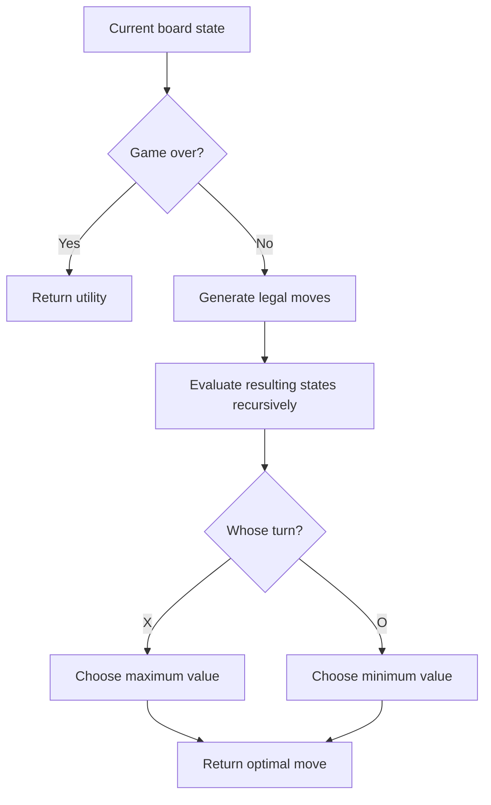

# Tic-Tac-Toe | Adversarial Search with Minimax

**Harvard CS50's Introduction to Artificial Intelligence with Python — Project 0b**

A playable Tic-Tac-Toe application that demonstrates **adversarial search** and **optimal decision-making** in a deterministic, two-player, zero-sum game. The program combines a Python game-state engine with a graphical interface built using Pygame.

> **Academic context:** This project was completed as part of Harvard's CS50AI coursework. The original assignment and distribution materials belong to their respective authors. This document describes the implementation and its learning outcomes; it does not reproduce the solution code.

## Project overview

The player competes against an AI that evaluates the possible outcomes of legal moves using the **Minimax algorithm**. `X` plays first, the players alternate turns, and the game ends when either player completes three marks in a row or the board fills without a winner.

The implementation includes:

- A 3 × 3 interactive board, with the option to play as `X` or `O`.
- Legal-move generation and immutable-style board transitions (moves are applied to copies).
- Detection of horizontal, vertical, and diagonal wins, draws, and terminal positions.
- Recursive Minimax evaluation for both maximizing and minimizing players.
- A Pygame interface with game-status messages and a **Play Again** option.

## How Minimax works

The board is represented as a nested list, with each cell holding `"X"`, `"O"`, or `None`. The AI explores possible moves, alternating between two decision makers:

- **MAX (`X`)** seeks to maximize the utility of the final board.
- **MIN (`O`)** seeks to minimize the utility of the final board.

The utility function assigns:

| Terminal outcome | Utility |
| --- | ---: |
| `X` wins | `+1` |
| `O` wins | `-1` |
| Draw | `0` |

The recursive evaluation follows these principles:

\[
V(s) = \begin{cases}
U(s) & \text{if } s \text{ is terminal} \\
\max_{a \in A(s)} V(\mathrm{Result}(s,a)) & \text{if X plays} \\
\min_{a \in A(s)} V(\mathrm{Result}(s,a)) & \text{if O plays}
\end{cases}
\]



This is **full recursive Minimax**, not alpha-beta pruning or a machine-learning model. If several moves have the same optimal value, the implementation can choose any of them; the exact choice may vary because legal actions are stored in a set.

## Project structure

```text
 tictactoe/
 ├── tictactoe.py          # Game rules, states, utility and Minimax search
 ├── runner.py             # Interactive Pygame application
 ├── requirements.txt      # Pygame dependency
 ├── OpenSans-Regular.ttf  # Font used by the graphical interface
 └── README.md             # Project documentation
```

Python may create a `__pycache__/` directory automatically when the program is run; these generated files are not required for installation.

### Key functions in `tictactoe.py`

| Function | Purpose |
| --- | --- |
| `initial_state()` | Creates an empty 3 × 3 board. |
| `player(board)` | Determines whose turn comes next. |
| `actions(board)` | Returns the set of available `(row, column)` moves. |
| `result(board, action)` | Returns a new board after a valid move. |
| `winner(board)` | Checks all eight possible winning lines. |
| `terminal(board)` | Detects a win or a full board. |
| `utility(board)` | Assigns terminal scores of `+1`, `-1`, or `0`. |
| `minimax(board)` | Selects an action that optimizes the current player's outcome. |

`runner.py` handles window events, mouse input, rendering, turn-taking, and restarting a completed game.

## Requirements

- Python 3 (Python 3.12 was used for this coursework).
- [Pygame](https://www.pygame.org/).
- A desktop environment capable of opening a graphical window.

No model training, dataset download, or GPU is required.

## Run locally

Open a terminal in the folder containing `runner.py`:

**Windows PowerShell**

```powershell
cd "X:\IO++\GitHub Upload\tictactoe"
python -m pip install -r requirements.txt
python runner.py
```

**macOS / Linux**

```bash
python3 -m pip install -r requirements.txt
python3 runner.py
```

The game starts with buttons to **Play as X** or **Play as O**. Click an empty square to make a move; after the game ends, use **Play Again** to restart.

> Run the program from the project directory so that `runner.py` can find `OpenSans-Regular.ttf` using its relative path.

## Verified behavior

A lightweight functional check on the supplied Python game engine confirmed:

- The initial board contains **9 available actions**, and `X` moves first.
- In the test position below, the AI selects the immediate winning move `(0, 2)` for `X`.

```text
 X | X | .
---+---+---
 O | O | .
---+---+---
 . | . | .
```

After `X` plays at `(0, 2)`, `winner(board)` reports `X`. This verifies the demonstrated position; it is not a claim of exhaustive test coverage of all possible game states.

## Technical skills demonstrated

**Python · Artificial Intelligence · Adversarial Search · Minimax · Game Theory · Recursion · State-Space Search · Decision Making · Pygame**

The project illustrates how to model a decision problem with states, available actions, transitions, terminal conditions, and a utility function—concepts applicable to planning and autonomous decision-making beyond board games.

## Course and attribution

- **Course:** [CS50's Introduction to Artificial Intelligence with Python](https://cs50.harvard.edu/ai/)
- **Assignment:** [Tic-Tac-Toe](https://cs50.harvard.edu/ai/projects/0/tictactoe/)
- **Institution:** Harvard University / CS50
- **Certificate verification:** [CS50AI completion certificate](https://cs50.harvard.edu/certificates/4d1848b5-b7cc-4b37-8155-819e19e6054d)

**Academic integrity:** CS50 coursework solutions should not be published in a way that makes them available to other students. Keep course-solution source files private unless CS50 explicitly authorizes their public release. This README can be used publicly to document the project and learning outcomes.
